  
 
  
 <table> <tr> <td width="260" align="center">     <b>Guilherme Almeida</b>  Guix-plx · São Paulo, BR </td> <td>
Olá, tudo bem? Eu sou o Guilherme 👋

Estudante de Ciência da Computação, apaixonado por tecnologia e movido por uma curiosidade insaciável. Adoro explorar tanto o Front-end quanto o Back-end, buscando sempre entender como as coisas funcionam por trás dos panos.

Acredito muito no uso da Inteligência Artificial como aliada poderosa nos estudos, utilizando-a para desconstruir e compreender a resolução de problemas complexos e evoluir minha lógica de programação.

</td> </tr> </table>
🚀 Foco atual
🎓 Ciência da Computação: absorvendo os fundamentos teóricos e práticos da área
🧠 IA nos estudos: usando inteligência artificial para acelerar meu aprendizado e desvendar algoritmos
💻 Mentalidade Full-Stack: desenvolvendo habilidades tanto no Front-end quanto no Back-end
🛠️ Tecnologias

Linguagens: Python e Java
Editor: VS Code
Versionamento: Git e GitHub
🎮 Fora do código

Quando não estou construindo código ou quebrando a cabeça com algum algoritmo, você provavelmente vai me encontrar:

🏋️ Treinando na academia (mente sã, corpo são)
🕹️ Jogando alguma partida de FPS ou imerso na história de um bom RPG
📌 Projetos em destaque
Projeto	Descrição	Tecnologia
Violentos da Noite	Jogo 2D de terror e aventura, projeto acadêmico	Python
Chatbot	Chatbot em Tkinter para automação, cálculos de saúde (TDEE/BMR) e treinos	Python
petshop-denguinho-desktop	Sistema desktop para gerenciamento de um petshop, com POO e persistência de dados	Java
DevOps	Sistema web de gerenciamento de escalas e ponto eletrônico	PHP, MySQL, Docker

     

